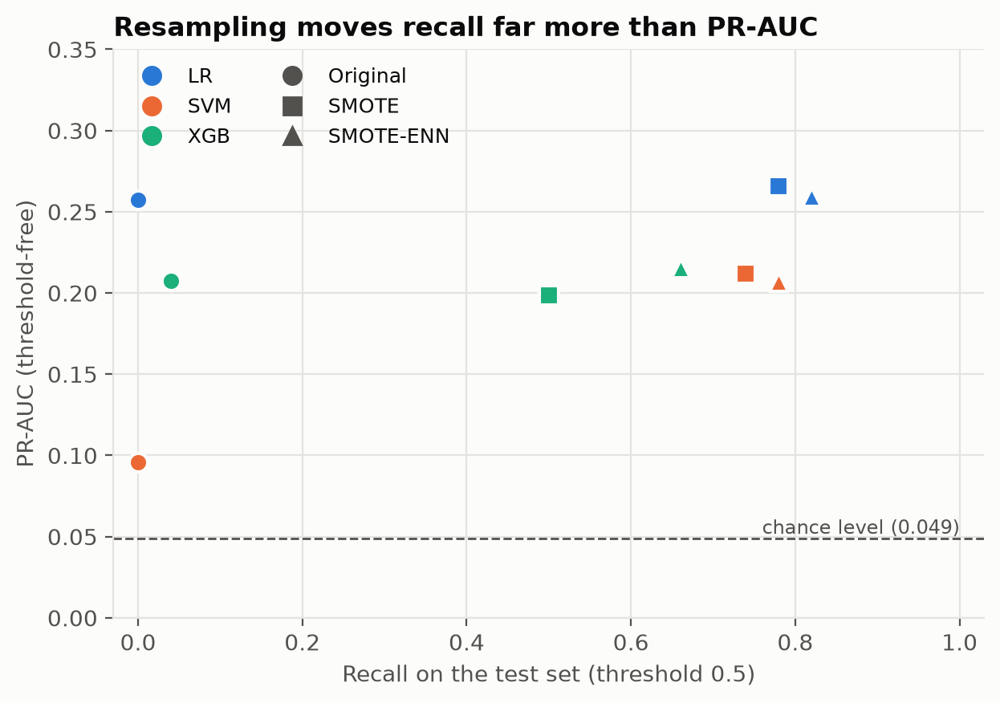

# Learning from Imbalanced Stroke Data: SMOTE vs SMOTE-ENN

Reproducible code and results for our IEEE ICISS 2026 paper comparing SMOTE and SMOTE-ENN resampling for stroke prediction with logistic regression, SVM and XGBoost on the Kaggle stroke dataset.

[](https://github.com/LambertAS/stroke-smote-vs-smoteenn/actions/workflows/tests.yml)
[](https://doi.org/10.1109/ICISS71466.2026.11715456)
[](requirements.txt)
[](LICENSE)

Table IV of the paper reproduces exactly, in every cell, on Linux (GitHub Actions). The cross-validation, SHAP and calibration results are reconstructions, because the original code for them was not kept.

**Paper:** L. A. Soehardjianto, W. Soetresno, E. F. A. Sihotang and M. Ohyver, "Learning from Imbalanced Stroke Data: A Comparative Study of SMOTE and SMOTE-ENN on Structured Health Records," *2026 13th International Conference on ICT for Smart Society (ICISS)*, Bandung, Indonesia, 2026, pp. 1-6, [doi:10.1109/ICISS71466.2026.11715456](https://doi.org/10.1109/ICISS71466.2026.11715456). All authors: BINUS University.

## Key findings

- **High accuracy can hide a useless model.** Trained on the raw data, all three models reach 0.951 accuracy on the test set, exactly what you get by predicting "no stroke" for everyone (972 of 1,022 patients). Yet logistic regression and SVM catch none of the 50 stroke patients (recall 0.000), and XGBoost catches 2 (recall 0.040).
- **Resampling makes the models flag far more stroke patients, but barely improves how they rank them.** After SMOTE or SMOTE-ENN, logistic regression and SVM catch 37 to 41 of the 50 stroke patients (recall 0.740 to 0.820). PR-AUC, which does not depend on a cut-off, hardly moves (logistic regression: 0.257 without resampling, 0.266 with SMOTE, 0.259 with SMOTE-ENN). This suggests that most of the gain is a shift in where the 0.5 cut-off falls rather than a better model; lowering the threshold of a model trained without resampling was not tested here.
- **SMOTE-ENN catches more strokes than SMOTE for every model, at the cost of more false alarms.** Recall rises from 0.780 to 0.820 (LR), 0.740 to 0.780 (SVM) and 0.500 to 0.660 (XGBoost), while precision falls.
- **The simplest model ranks best.** Logistic regression has the highest PR-AUC in every setting, and age is by far the strongest predictor.
- **The scores are not risk estimates.** After resampling, predicted probabilities are far higher than the observed stroke rate; they would need recalibration before being read as a patient's risk.

## Results at a glance



**Table IV**, hold-out test set (1,022 patients, 50 strokes), threshold 0.5. Paper profile, identical to the original notebook.

| Model | Resampling | Accuracy | Precision | Recall | F1 | PR-AUC |
|---|---|---|---|---|---|---|
| LR | Original | 0.951 | 0.000 | 0.000 | 0.000 | 0.257 |
| LR | SMOTE | 0.757 | 0.141 | 0.780 | 0.239 | 0.266 |
| LR | SMOTE-ENN | 0.717 | 0.128 | 0.820 | 0.221 | 0.259 |
| SVM | Original | 0.951 | 0.000 | 0.000 | 0.000 | 0.096 |
| SVM | SMOTE | 0.754 | 0.135 | 0.740 | 0.228 | 0.212 |
| SVM | SMOTE-ENN | 0.715 | 0.122 | 0.780 | 0.211 | 0.207 |
| XGB | Original | 0.951 | 0.500 | 0.040 | 0.074 | 0.207 |
| XGB | SMOTE | 0.889 | 0.221 | 0.500 | 0.307 | 0.199 |
| XGB | SMOTE-ENN | 0.819 | 0.164 | 0.660 | 0.263 | 0.215 |

The test set has only 50 stroke patients, so **one patient equals 2 points of recall** (0.02). Small differences between rows are within that granularity. Full-precision values: [results/paper/table4.csv](results/paper/table4.csv).

## Quickstart

Requires Python 3.12 (the pinned packages match the original Colab environment). The dataset is downloaded at runtime; no Kaggle account was needed at the time of writing.

Mac/Linux:

```bash
git clone https://github.com/LambertAS/stroke-smote-vs-smoteenn.git
cd stroke-smote-vs-smoteenn
make setup      # create .venv, install pinned packages and this package
make data       # download the dataset into data/raw/ and verify it
make reproduce  # paper profile (all tables and figures) and corrected profile
make test
```

Windows (PowerShell):

```powershell
git clone https://github.com/LambertAS/stroke-smote-vs-smoteenn.git
cd stroke-smote-vs-smoteenn
py -3.12 -m venv .venv            # or: uv venv --python 3.12 --seed .venv
.venv\Scripts\python -m pip install -r requirements.txt
.venv\Scripts\python -m pip install -e . --no-deps
.venv\Scripts\python -m stroke_imbalance.data
.venv\Scripts\python -m stroke_imbalance.run --config configs/paper.yaml
.venv\Scripts\python -m stroke_imbalance.run --config configs/corrected.yaml
.venv\Scripts\python -m pytest
```

**Expected runtime:** `reproduce` takes about 1 minute on a 16-core laptop and about 2.5 minutes on the 2-CPU GitHub runner, mostly for the Table V cross-validation; installing the packages takes under a minute on a fast connection. A single stage can be run with `--stages`, for example `--stages holdout,cv`.

**Platform note:** Linux is the reference platform. On Windows (the other platform tested), logistic regression and SVM reproduce exactly, but the XGBoost rows differ slightly, because XGBoost's random row and column sampling produces different draws on different platforms for the same seed. On any non-Linux platform (macOS included, not tested) the XGBoost cells of the reproduction test are skipped. The committed results in `results/` all come from the Linux CI run.

The notebooks in [notebooks/](notebooks/) (EDA and a results walkthrough) need JupyterLab, pinned separately in [requirements-dev.txt](requirements-dev.txt): `pip install -r requirements-dev.txt`, then `jupyter lab`.

## What is reproduced

| Paper item | Status | Script | Output |
|---|---|---|---|
| Table III, class counts per resampling regime | Exact | `run.py`, stage `holdout` | [table3_class_counts.csv](results/paper/table3_class_counts.csv) |
| Table IV, hold-out metrics | Exact on Linux (LR and SVM on every platform) | `run.py`, stage `holdout` | [table4.csv](results/paper/table4.csv) |
| Table V, 5x5 cross-validation | Reconstructed | `cv.py`, stage `cv` | [table5_cv.csv](results/paper/table5_cv.csv) |
| Table II, model settings | Corresponds to [configs/paper.yaml](configs/paper.yaml), which also holds two settings the paper's table omits: `colsample_bytree=0.8` and `n_jobs` for XGBoost | | |
| Fig 2, class distribution | Re-drawn from the notebook's plotting code, new style | `plots.py`, stage `eda` | [fig2_class_balance.png](results/paper/figures/fig2_class_balance.png) |
| Fig 3, distribution of numerical variables | Re-drawn, new style | `plots.py`, stage `eda` | [fig3_numeric_distributions.png](results/paper/figures/fig3_numeric_distributions.png) |
| Fig 4, BMI and glucose by stroke status | Re-drawn, new style | `plots.py`, stage `eda` | [fig4_bmi_glucose_by_stroke.png](results/paper/figures/fig4_bmi_glucose_by_stroke.png) |
| Fig 5, SHAP feature impact | Reconstructed | `explain.py`, stage `explain` | [fig5_shap_xgb_smote.png](results/paper/figures/fig5_shap_xgb_smote.png) |
| XGBoost gain, LR coefficient signs (text) | Reconstructed | `explain.py`, stage `explain` | [xgb_gain_smote.csv](results/paper/xgb_gain_smote.csv), [lr_coefficients_smote.csv](results/paper/lr_coefficients_smote.csv) |
| Fig 6, reliability curves and Brier scores | Reconstructed | `calibration.py`, stage `calibration` | [fig6_reliability_smote.png](results/paper/figures/fig6_reliability_smote.png), [brier_smote.csv](results/paper/brier_smote.csv) |
| Fig 1, Table I | Not code-generated | | |

"Exact" means every cell matches the original notebook's output. "Reconstructed" means the original code does not exist, so the analysis was rebuilt from the paper's description with fixed settings and was not tuned to match the paper. Every reconstructed number is compared with the paper in [docs/reproduction_report.md](docs/reproduction_report.md). In short, every Table V mean lies within about one of the paper's standard deviations, the SHAP top five match in order, the LR coefficient signs match, and the Brier scores are 0.164 / 0.145 / 0.080 against the paper's 0.164 / 0.145 / 0.077.

<details>
<summary>Table V cross-validation: paper vs this repo (mean ± standard deviation over 25 folds)</summary>

5x5 repeated stratified cross-validation on the 4,088 training rows, with scaling and resampling inside each fold. Per-fold scores: [table5_cv_folds.csv](results/paper/table5_cv_folds.csv).

| Model | Resampling | PR-AUC paper | PR-AUC repo | Recall paper | Recall repo | F1 paper | F1 repo |
|---|---|---|---|---|---|---|---|
| LR | SMOTE | 0.197 ± 0.031 | 0.188 ± 0.034 | 0.769 ± 0.049 | 0.762 ± 0.055 | 0.227 ± 0.013 | 0.224 ± 0.018 |
| LR | SMOTE-ENN | 0.197 ± 0.030 | 0.188 ± 0.035 | 0.827 ± 0.054 | 0.841 ± 0.044 | 0.214 ± 0.011 | 0.216 ± 0.014 |
| SVM | SMOTE | 0.146 ± 0.031 | 0.132 ± 0.020 | 0.655 ± 0.053 | 0.612 ± 0.066 | 0.201 ± 0.012 | 0.189 ± 0.020 |
| SVM | SMOTE-ENN | 0.149 ± 0.031 | 0.132 ± 0.020 | 0.715 ± 0.049 | 0.704 ± 0.058 | 0.201 ± 0.009 | 0.194 ± 0.017 |
| XGB | SMOTE | 0.144 ± 0.020 | 0.154 ± 0.032 | 0.301 ± 0.052 | 0.272 ± 0.064 | 0.202 ± 0.031 | 0.187 ± 0.037 |
| XGB | SMOTE-ENN | 0.154 ± 0.021 | 0.155 ± 0.035 | 0.528 ± 0.072 | 0.521 ± 0.078 | 0.229 ± 0.026 | 0.221 ± 0.030 |

</details>

## Method summary

- **Data:** Kaggle "Stroke Prediction Dataset" (fedesoriano), 5,110 patients, 249 strokes (4.87%), 10 features. `id` is dropped.
- **Preprocessing:** missing BMI (201 rows) filled with the mean; five categorical columns label-encoded with fixed maps (for example work_type: Private 0, Self-employed 1, Govt_job 2, children 3, Never_worked 4).
- **Split:** stratified 80/20, `random_state=42`: 4,088 training rows (199 strokes), 1,022 test rows (50 strokes). Min-max scaling fit on the training set.
- **Resampling** (training set only): none, `SMOTE(random_state=42)` (to 3,889 / 3,889), `SMOTEENN(random_state=42)` (to 3,148 / 3,618).
- **Models:** `LogisticRegression(max_iter=1000)`, `SVC(kernel="rbf", probability=True)`, `XGBClassifier(n_estimators=200, learning_rate=0.05, max_depth=4, subsample=0.8, colsample_bytree=0.8)`, all with `random_state=42`. Settings are fixed; there is no hyperparameter search.
- **Metrics:** accuracy, precision, recall and F1 for the stroke class at threshold 0.5, and PR-AUC (`average_precision_score`), on the untouched test set. Ranked on PR-AUC and recall.
- **Cross-validation (Table V):** `RepeatedStratifiedKFold(5 splits, 5 repeats)` on the training set, with scaling and resampling inside each fold (`imblearn` Pipeline).

All settings live in [configs/paper.yaml](configs/paper.yaml).

## Methodology notes and limitations

- **Resampling is applied after the split, to the training data only.** The test set is never resampled; a test checks this.
- **BMI imputation leaks slightly.** The paper profile fills missing BMI with the mean of the full dataset before splitting (201 of 5,110 rows). The corrected profile learns the mean from the training rows only. LR and SVM change by at most one test patient; XGBoost recall changes by up to 3 patients (SMOTE-ENN: 0.66 to 0.60). See [the comparison](results/corrected/table4_vs_paper.md).
- **Label encoding and SMOTE do not mix well.** Nominal variables are label-encoded, so SMOTE interpolates between category codes and creates values that do not exist (for example work_type 2.4) and non-binary hypertension values. A one-hot / SMOTENC variant was not run here (see future work).
- **Recall gains look like an operating-point shift.** PR-AUC changes little with resampling (LR 0.257 to 0.266) while recall at the fixed 0.5 threshold jumps. This suggests that much of the gain could also be had by lowering the threshold of a model trained without resampling, but that was not tested here (see future work).
- **One split, 50 positives.** All Table IV numbers come from a single 80/20 split with 50 stroke patients in the test set; one patient is 2 points of recall. The cross-validation in Table V gives a sense of the spread.
- **No hyperparameter search.** All settings are fixed defaults or the values above.
- **Probabilities are distorted.** Resampling inflates predicted probabilities (Fig 6); they need recalibration before being read as risk.
- **Data.** One public dataset of unclear clinical provenance, 10 features, no external validation.
- **Future work, not done here:** bootstrap confidence intervals for recall and PR-AUC on the test set; one-hot encoding with SMOTENC so synthetic patients keep valid categories; a no-resampling baseline whose threshold is tuned (on training-set CV) to match SMOTE's recall, to measure how much of the gain is a threshold shift.

## Differences from the paper

<details>
<summary>Eight differences between the paper's text and the code or data (click to expand)</summary>

- **Section G, SMOTE vs SMOTE-ENN within one standard deviation.** The paper says the gap between SMOTE and SMOTE-ENN is within one standard deviation for every model. Using the paper's own Table V, this holds for PR-AUC for all three models. It does not hold for recall: for XGBoost the gap (0.301 vs 0.528) is several standard deviations, and for LR (0.769 vs 0.827) and SVM (0.655 vs 0.715) it is slightly larger than one standard deviation. The reconstruction shows the same pattern.
- **Stroke prevalence.** The introduction gives 4.78%; the data give 249 / 5,110 = 4.87%.
- **Tuning and validation.** The paper describes light tuning and a validation subset. The code used fixed settings and no validation split.
- **Table IV rounding.** Two PR-AUC values in the paper are truncated rather than rounded: SVM without resampling (0.0958, shown as 0.09) and XGBoost with SMOTE (0.1988, shown as 0.19).
- **SVM threshold.** Table II lists a 0.5 threshold for all models. The code takes SVM labels from `predict()`, which uses the sign of the decision function, not a 0.5 cut on the Platt-scaled probability; the two can disagree for a few patients. This repo follows the code.
- **XGBoost threads.** The notebook sets `n_jobs=-1`, which is not in Table II. On Colab this meant 2 threads, and XGBoost results depend on the thread count, so this repo pins `n_jobs: 2`.
- **BMI imputation.** The full-dataset mean is used before the split (see above); the corrected profile shows the effect.
- **Reconstructed analyses** (Table V, Fig 5, Fig 6, gain and coefficients) were rebuilt without the original code; their numbers are close to the paper's but not identical. Details: [docs/reproduction_report.md](docs/reproduction_report.md).

</details>

## Repository structure

<details>
<summary>Folder layout (click to expand)</summary>

```
configs/          paper.yaml (replicates the notebook), corrected.yaml (train-only BMI imputation)
src/stroke_imbalance/
  data.py         download, SHA-256 check, load
  features.py     encoding maps, imputation, split, scaling
  resampling.py   none / SMOTE / SMOTE-ENN
  models.py       model factory from the config
  evaluate.py     hold-out metrics, table comparison
  cv.py           Table V cross-validation
  explain.py      SHAP, XGBoost gain, LR coefficients
  calibration.py  Brier scores, reliability curves
  plots.py        all figures, one style
  run.py          CLI: python -m stroke_imbalance.run --config configs/paper.yaml
results/paper/    tables (CSV + Markdown) and figures, paper profile
results/corrected/ corrected profile and its comparison with the paper profile
tests/            reproduction test (Table IV vs notebook), preprocessing checks, smoke tests
notebooks/        EDA and results walkthrough (outputs cleared)
archive/          the original Colab notebook, unchanged
docs/             reproduction report (paper vs notebook vs repo, every number)
data/             data README; raw data is downloaded here and not committed
```

</details>

## Data source and license

The data come from the [Stroke Prediction Dataset](https://www.kaggle.com/datasets/fedesoriano/stroke-prediction-dataset) by fedesoriano on Kaggle. The dataset is **downloaded at runtime and not redistributed** in this repository. Each load checks the file's SHA-256, row count and number of strokes ([data/README.md](data/README.md)).

On the [dataset page](https://www.kaggle.com/datasets/fedesoriano/stroke-prediction-dataset), Kaggle shows the license as "Data files © Original Authors". The description gives the source as "(Confidential Source) - Use only for educational purposes" and asks: "If you use this dataset in your research, please credit the author." Check the page for the current terms before reusing the data.

## How to cite

If you use this work, please cite the paper:

```bibtex
@inproceedings{soehardjianto2026learning,
  author    = {Soehardjianto, Lambert Aditama and Soetresno, Wilsen and Sihotang, Erna Fransisca Angela and Ohyver, Margaretha},
  title     = {Learning from Imbalanced Stroke Data: A Comparative Study of {SMOTE} and {SMOTE-ENN} on Structured Health Records},
  booktitle = {2026 13th International Conference on ICT for Smart Society (ICISS)},
  address   = {Bandung, Indonesia},
  publisher = {IEEE},
  year      = {2026},
  pages     = {1--6},
  doi       = {10.1109/ICISS71466.2026.11715456}
}
```

GitHub also offers a "Cite this repository" button based on [CITATION.cff](CITATION.cff).

## License and acknowledgements

The code is released under the [MIT License](LICENSE). The license covers the code only: the paper is copyright IEEE (read it via the DOI above), and the dataset is not covered (see above).

Authors: Lambert Aditama Soehardjianto, Wilsen Soetresno, Erna Fransisca Angela Sihotang and Margaretha Ohyver (BINUS University). Thanks to fedesoriano for publishing the dataset, and to the maintainers of scikit-learn, imbalanced-learn, XGBoost and SHAP.
